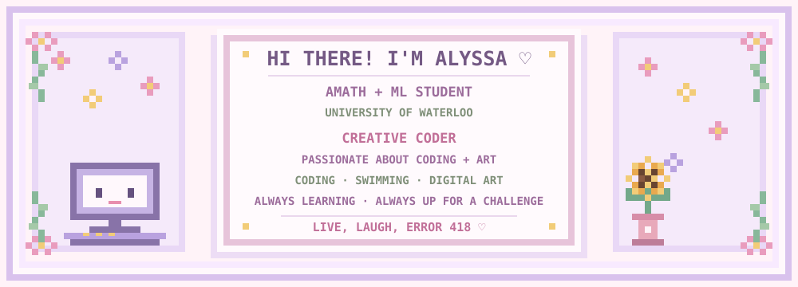

   

### 💫 Active Developer & Creative Coder

🎓 **University of Waterloo** 
💻 **Passionate about:** Coding + art 
🌱 **Currently:** Exploring new technologies 
💪 **Life Motto:** Live, Laugh, ERROR 418

### 🌸 About Me

✨ Excited to learn more about programming! 
🎨 I enjoy coding, swimming, and digital art. 
🚀 Always up for a new challenge!

 

---

### 👾 My Contribution Arcade

### 🔗 Connect with Me

### 🛠️ Tools & Technologies

  
  
  
  
  
   
  
  
  
  
  

